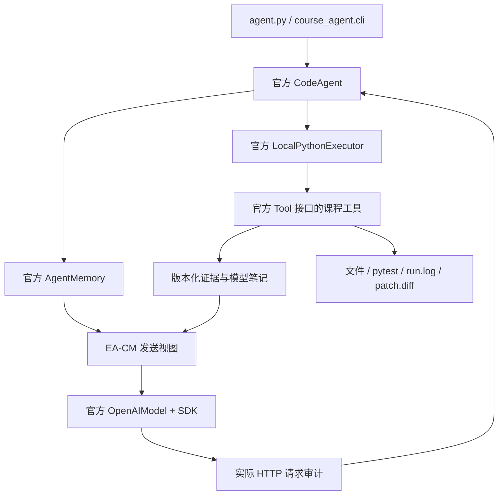

# smolagents 官方内核与 EA-CM

## 来源与开发起点

本分支从最后一个未引入自写 v2 内核的 `b5d2181` 开始。根据用户补充的课堂许可，直接内置官方运行包，不再自行实现 Agent 主循环或 Python 执行器。

- 上游：huggingface/smolagents，Apache-2.0。
- 版本：1.26.0。
- 固定提交：`12c1bc820eca50ace6f80a21d90426d41d74f845`。
- 位置：`vendor/smolagents/`；完整 `src/`、提示词、许可证、上游项目说明和项目元数据共 24 个文件。
- 清单：`UPSTREAM.json` 逐文件记录 Git blob SHA-1、SHA-256 和字节数。
- `verify_vendor.py` 校验每个文件与清单，拒绝缺失或额外的运行包文件。
- 第三方依赖固定在 `requirements.txt`；来源范围在 `requirements.in`，本次验证环境为 WSL Python 3.12。

官方源码目录不作本地修改。`.gitattributes` 对该目录禁用文本换行转换，保留官方原始字节和空白。

## 运行路径

`CourseCodeAgent` 仅覆盖两个接口：

1. `write_memory_to_messages()`：证据模式交给 EA-CM；`upstream` 模式直接调用官方实现。
2. `provide_final_answer()`：阻止官方在最大步数之后额外请求一次模型，按课程预算失败退出。

`_run_stream`、`_step_stream`、代码解析与 `create_python_executor` 均直接继承官方实现。跨轮变量、Python 语法执行和 `AgentError` 恢复由官方负责。没有第二套动作 JSON 协议、自制执行 AST 白名单、RPC 执行器或 Agent 状态机。

项目工具通过官方 `Tool` 包装接口接入。文件范围、版本冲突、基线和最终测试、双子任务顺序、论文笔记是课程业务约束，集中在 `session.py`、`policy.py`、`workspace.py`；源码 AST 仅用于提取阅读单位和检查课程规定的函数定义，不用于执行模型代码。

## EA-CM 的职责

官方 `AgentMemory` 保留完整步骤。EA-CM 构建新的消息列表，不删除官方历史；完整工具结果另外保存在日志和证据存储中。

| 接口 | 行为 |
|---|---|
| `observe` | 接收真实工具结果，建立来源、哈希、行范围或 PDF 页码对应的证据 |
| `build` | 保留系统与任务、有界状态及最小错误反馈，先安排必需笔记/原文，再扩展近期反馈 |
| `mark_exposed` | 检查实际 HTTP 请求和返回内容，登记真正呈现过的原文与笔记 |
| `invalidate` | 来源哈希改变时失效对应证据和笔记；验证也绑定当前文件版本 |

同一文件、版本及范围共用一个证据 id。近期执行输出中的重复全文换成证据提示，完整内容仍可在官方记忆和日志中查看。源码原始全文只需读取一次，发送时按完整类、完整函数和独立调用组织；课程首次编辑要求与选择器共享同一份证据状态。

普通文件可按实际剩余容量分为连续范围，只有真实请求中收到全部范围才登记为完整呈现；论文页面和题目指定的源码机制保持完整。基础题与一般编辑任务额外检查目标当前版本是否已呈现，模型刚写入且未被外部改变的版本可继续编辑。停滞诊断只保留计数和工具名，不再次注入完整工具结果。

`write_note` 要求文本实际出现在刚收到的模型响应中，且引用的证据已向模型呈现。源码笔记绑定相关文件的完整阅读单位；论文笔记绑定页码。不能在修改决定之后补造一份笔记来满足先前的阅读要求。

召回返回可排入的条目和待处理条目。下一请求仍按完整体积复核，超额条目留在队列，不把超额召回升级为不可恢复的错误。

论文阅读期间先安排未呈现页面，再利用剩余空间复用笔记；全部阅读完成后，五份最终笔记一起进入后续请求，再允许报告写入。状态持续列出剩余阅读、笔记、编辑和验证事项；低剩余调用预算时提示预留交付步骤，连续无进展时显示缺项和近期重复工具结果。

## 模型预算与日志

首轮协议固定 `deepseek-flash`，输出上限 4096，`thinking.type=disabled`。关闭框架重试和 SDK 重试；关闭额外规划请求与运行总结请求。网络等待为配置中的 210 秒，原生运行器保留课程代理的独立超时口径。

HTTP 请求钩子读取 SDK 实际构造的 JSON，合并后的 `thinking` 字段也在其中。字符数按课程要求的紧凑 JSON、`ensure_ascii=False` 计算；源码最多 20 次、论文最多 40 次，长上下文每次最多 32,000 字符。基础题采用课程评测器对 content 的序列化口径，默认限制为 15,000，低于课程 16,000 上限。选择器和实际发送钩子共用计量函数；历史 `content_chars` 诊断字段保留含义，新增 `course_content_chars` 表示课程口径。

每次真实尝试对应一条 `model_request` 和 `model_response` 或 `model_error`。原始响应完整保留，usage 同时发出课程兼容记录。缺失或无效 usage 标为不完整；已观察 token 合计不代表未知部分为零。空正文截断、非空截断、空正文、HTTP/网络错误、官方解析/执行错误分别记录。官方把空 Python 正文视为无操作时，不伪造解析错误；EA-CM 在下一请求明确呈现 `truncated_empty` 等诊断。

## 验证与正式评测边界

离线测试使用真实的官方 Agent、执行器、SDK 和 HTTP 钩子，HTTP 返回由 MockTransport 提供。包含真实文件修改和本地 pytest，以及课程原始三份源码和 52 页 PDF 的上下文容量检查。**模拟响应与容量检查不能作为课程功能得分或真实模型成功率。**

`evaluate_course.py` 默认只做离线预检：复制源码和提示词到原生 Linux 文件系统，校验指纹及上游清单，启动复制后的入口，运行源码基线，重复提取 PDF 并核对一致性。付费运行需明确指定 `--run-paid` 和阶段；运行结束或异常时归档日志，保留原生结果，不自动重跑。

正式验收顺序为单题 smoke、基础五题、源码题、论文题。分别记录进程完成状态、过程检查、功能评分和真实用量。只有全部完成且用量完整的轮次才用于比较。

本实现面向可信的课程工作副本。官方本地执行器和受限业务工具不等同于操作系统级沙箱；首次实现维持单 Agent 和串行工具执行。
