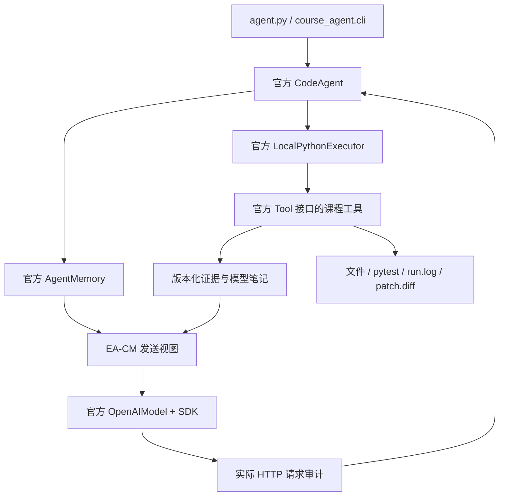

# smolagents 官方内核与 EA-CM

## 来源与开发起点

本分支从最后一个未引入自写 v2 内核的 `b5d2181` 开始。根据用户补充的课堂许可，直接内置官方运行包，不再自行实现 Agent 主循环或 Python 执行器。

- 上游：huggingface/smolagents，Apache-2.0。
- 版本：1.26.0。
- 固定提交：`12c1bc820eca50ace6f80a21d90426d41d74f845`。
- 位置：`vendor/smolagents/`；完整 `src/`、提示词、许可证、上游项目说明和项目元数据共 24 个文件。
- 清单：`UPSTREAM.json` 逐文件记录 Git blob SHA-1、SHA-256 和字节数。
- `verify_vendor.py` 校验每个文件与清单，拒绝缺失或额外的运行包文件。
- 第三方依赖固定在 `requirements.txt`；来源范围在 `requirements.in`，本次验证环境为 WSL Python 3.12。

官方源码目录不作本地修改。`.gitattributes` 对该目录禁用文本换行转换，保留官方原始字节和空白。

## 运行路径

`CourseCodeAgent` 仅覆盖两个接口：

1. `write_memory_to_messages()`：证据模式交给 EA-CM；`upstream` 模式直接调用官方实现。
2. `provide_final_answer()`：阻止官方在最大步数之后额外请求一次模型，按课程预算失败退出。

`_run_stream`、`_step_stream`、代码解析与 `create_python_executor` 均直接继承官方实现。跨轮变量、Python 语法执行和 `AgentError` 恢复由官方负责。没有第二套动作 JSON 协议、自制执行 AST 白名单、RPC 执行器或 Agent 状态机。

当前配置使用官方 Markdown Python 代码块输出；可配置启用官方结构化 `thought/code` 协议。两种模式均由官方解析器处理。长上下文两题通过官方 `prompt_templates` 接口加载对应模式的课程精简模板（`course_agent/prompts.py`），动态工具说明仍由官方生成。基础题使用官方模板；历史回放使用原记录的输出模式。DeepSeek Chat接口仅支持 `json_object`，模型适配器只将官方的 `json_schema` 请求参数映射为此模式，不修改返回正文；JSON格式约束不等于严格Schema约束。请求估计与实际发送共用同一参数准备函数。历史发送视图只保留完整真实模型输出为assistant消息，裁剪片段作为参考数据；不合成另一种动作格式。错误响应继续交给官方错误恢复，不增加DSML/XML转换器。历史离线回放保留原记录的输出模式与代码块配置。

项目工具通过官方 `Tool` 包装接口接入。文件范围、版本冲突、基线和最终测试、双子任务顺序、论文笔记是课程业务约束，集中在 `session.py`、`policy.py`、`workspace.py`；源码 AST 仅用于提取阅读单位和检查课程规定的函数定义，不用于执行模型代码。

`CourseSession` 根据真实阅读、文件版本与命令结果生成不可变的 `TaskProgress`。编辑前检查、`task_status`、EA-CM 状态提示和最终检查读取同一份要求；上下文层不再解析状态文案来推断是否完成。工具适配器根据同一参数声明构造 Python `Signature`，按标准绑定规则接收位置和关键字参数，然后进行原有类型与业务检查。

运行停滞由官方 `ActionStep` 回调观察：实际步骤没有新增阅读、笔记、版本或验证，且连续六步重复至多两种动作时停止并留档。单纯构建发送视图不会推进运行计数；不同动作构建解释器变量可以正常继续。官方循环、步骤执行和错误恢复方法保持直接继承。

## EA-CM 的职责

官方 `AgentMemory` 保留完整步骤。EA-CM 构建新的消息列表，不删除官方历史；完整工具结果另外保存在日志和证据存储中。

发送视图的必需部分包括任务、精确的当前计划、统一进度快照和当前错误。快照持续保留已修改文件、基线完成情况和当前版本的验证情况。完整助手动作保留官方代码标签；裁剪或解析失败的动作只作为参考数据呈现，不作为助手历史示例。原文证据获得容量后，再扩展近期反馈。

| 接口 | 行为 |
|---|---|
| `observe` | 接收真实工具结果，建立来源、哈希、行范围或 PDF 页码对应的证据 |
| `build` | 保留系统与任务、有界状态及最小错误反馈，先安排必需笔记/原文，再扩展近期反馈 |
| `mark_exposed` | 检查实际 HTTP 请求和返回内容，登记真正呈现过的原文与笔记 |
| `invalidate` | 来源哈希改变时失效对应证据和笔记；验证也绑定当前文件版本 |

同一文件、版本及范围共用一个证据 id。未形成笔记的源码机制与显式读取的有效相邻范围构成持续工作集；上轮已呈现不代表本轮可以省略。选择时先预留必需机制，再在完整请求预算允许时用同源同版本的大范围替换被包含的片段；放不下的大范围保持排队，不能挤掉必需机制。近期执行输出中的重复全文换成证据提示，完整内容仍可在官方记忆和日志中查看。源码原始全文只需读取一次，发送时按完整类、完整函数和独立调用组织；课程首次编辑要求与选择器共享同一份证据状态。

普通文件可按实际剩余容量分为连续范围，只有真实请求中收到全部范围才登记为完整呈现；论文页面和题目指定的源码机制保持完整。基础题与一般编辑任务额外检查目标当前版本是否已呈现，模型刚写入且未被外部改变的版本可继续编辑。停滞诊断只保留计数和工具名，不再次注入完整工具结果。

`write_note` 要求文本实际出现在刚收到的模型响应中，且引用的证据已向模型呈现。源码笔记绑定相关文件的完整阅读单位；论文笔记绑定页码。不能在修改决定之后补造一份笔记来满足先前的阅读要求。

召回返回可排入的条目和待处理条目。下一请求仍按完整体积复核，超额条目留在队列，不把超额召回升级为不可恢复的错误。

显式文件/PDF读取与召回共用原文需求队列：重复读取复用已有证据id，但会重新要求发送原文；已有笔记不会取消这次需求。只有实际HTTP请求包含完整内容或完整连续范围才确认交付。源码全文读取会说明发送范围为课程规定的完整机制，其余位置可通过read_range/read_symbol要求发送；完整原文件仍保存在工具返回值与run.log中。

论文阅读先由 Agent 一次提取所需页码至本地证据存储，提取成功不等于模型已阅读；完整页面仍按请求预算分批送达。工具说明统一标注字典返回字段和 Python 列表参数，模型只能引用实际送达原文的证据 id。最终笔记须保存对应问题的答案、页码和连续原文引用。

论文按页码组成连续原文批次，遇到首个放不下的页面就结束本批，不跳页填空。成功动作后可继续下一批，不要求每页被笔记引用。模型可先保存某主题已证实的部分，不必等两个问题齐全；后续增量更新应保留已确认的答案、页码与连续引用。全部必需页真实入模后，回看请求优先发送新需求，并用余量保留上一实际请求的相关原文，优先最近新回看的页，避免组合两个问题时来回丢失证据。网络/空响应或官方解析、执行错误后，从上一发送清单恢复当前批次到既有 pending 队列，不回滚真实曝光记录，也不重发全部历史。入模仅证明材料交付；只有实际笔记事件证明生成了笔记，不维护“已理解”标记。

五份最终有效笔记必须共同出现在后续真实请求中，再允许报告写入。更新一份笔记即取消该份旧版本的当前复用资格，等待下一次HTTP曝光确认。报告初始阅读只检查首次写入前；写入报告会正常失效其旧原文，但不再重新要求初始阅读，不影响PDF覆盖。状态、编辑门槛和最终检查共享同一份缺项记录。

## 模型预算与日志

历史首轮使用 `deepseek-flash`、4096输出和关闭thinking，但这不是题目1、2的课程限制。客户端现通过官方 OpenAIModel 参数读取 config.json 的 max_tokens、thinking、reasoning_effort、temperature、top_p；未配置项交由服务端决定。当前两题设置为16384输出上限、thinking enabled、reasoning_effort high。题目3才由课程转发器施加统一采样参数。关闭框架/SDK自动重试及额外规划、总结请求；网络等待仍为配置中的210秒。

HTTP 请求钩子读取 SDK 实际构造的 JSON，合并后的 `thinking` 字段也在其中。字符数按课程要求的紧凑 JSON、`ensure_ascii=False` 计算；源码最多 20 次、论文最多 40 次，长上下文每次最多 32,000 字符。基础题采用课程评测器对 content 的序列化口径，默认限制为 15,000，低于课程 16,000 上限。选择器和实际发送钩子共用计量函数；历史 `content_chars` 诊断字段保留含义，新增 `course_content_chars` 表示课程口径。

每次真实尝试对应一条 `model_request` 和 `model_response` 或 `model_error`。原始响应完整保留，usage 同时发出课程兼容记录。缺失或无效 usage 标为不完整；已观察 token 合计不代表未知部分为零。空正文截断、非空截断、空正文、HTTP/网络错误、官方解析/执行错误分别记录。官方把空 Python 正文视为无操作时，不伪造解析错误；EA-CM 在下一请求明确呈现 `truncated_empty` 等诊断。

## 验证与正式评测边界

离线测试使用真实的官方 Agent、执行器、SDK 和 HTTP 钩子，HTTP 返回由 MockTransport 提供。包含真实文件修改和本地 pytest，以及课程原始三份源码和 52 页 PDF 的上下文容量检查。**模拟响应与容量检查不能作为课程功能得分或真实模型成功率。**

`evaluate_course.py` 默认只做离线预检：复制源码和提示词到原生 Linux 文件系统，校验指纹及上游清单，启动复制后的入口，运行源码基线，重复提取 PDF 并核对一致性。付费运行需明确指定 `--run-paid` 和阶段；运行结束或异常时归档日志，保留原生结果，不自动重跑。

当前授权验收顺序为源码题、论文题；已有 smoke 记录保留，本次不扩大到基础五题或排名题。分别记录进程完成状态、过程检查、功能评分和真实用量。只有全部完成且用量完整的轮次才用于比较。

本实现面向可信的课程工作副本。官方本地执行器和受限业务工具不等同于操作系统级沙箱；首次实现维持单 Agent 和串行工具执行。

新 PDF 批次接纳时预留 768 字符用于下一轮状态与最小错误反馈；已入模后需要恢复的页面可以使用这部分余量，避免状态增长挤出原文。详细工具说明仅用于长上下文题型。通过官方 `executor_kwargs.timeout_seconds` 将动作超时设为命令工具超时加 5 秒，默认 125 秒；命令仍有自身 120 秒上限。
